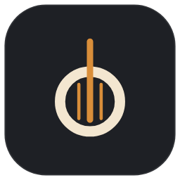

<div align="center">



# Kora ADE

**Seus projetos, seus agentes, cada conversa no lugar certo.**

Ambiente de desenvolvimento para trabalhar com agentes de IA — Claude Code e Codex — organizado por projeto,
com cada aba de terminal presa à sua conversa.

[Site](https://kora-ade.vercel.app/) · [Baixar](https://github.com/EduardoAndradeMachado/kora-ade/releases/latest) · Beta · Windows 10/11

</div>

---

## Por que existe

Quem trabalha com vários projetos e vários agentes ao mesmo tempo acaba com uma pilha de terminais sem nome
e sem saber qual conversa estava em qual. O Kora organiza isso: cada projeto tem as suas abas, cada aba sabe
qual sessão do Claude ou do Codex está rodando nela, e fechar o computador não perde nada — na próxima abertura,
**Continuar chat** retoma exatamente aquela conversa.

## O que ele faz

- **Projetos na lateral**, em categorias e subcategorias que você cria (por empresa, cliente, fase…), com uma
  seção **Ocultos** para o que não está em uso — dá para ocultar um projeto ou uma categoria inteira.
  Cada projeto pode ganhar um nome só dele no Kora, sem renomear a pasta. Se a pasta for movida ou apagada
  fora do Kora, ele avisa e oferece localizar a pasta nova (abas e categoria continuam) ou remover da lista.
- **Abas de terminal por projeto.** Abas do Claude e do Codex ficam ligadas à sessão, sem configurar nada:
  o Kora lê o que os próprios agentes já gravam no disco.
- **Sessões da pasta:** a lista de conversas do Claude e do Codex daquele projeto, para abrir, fixar como aba ou apagar.
- **Arquivos:** explorador com as cores do git, que acompanha o que os agentes criam e movem; editor de código,
  Markdown com visualização, PDF e imagem em aba; arrastar para mover e renomear com F2.
- **Git:** branch atual, locais, remotas e worktrees; criar e trocar branch; iniciar repositório e vincular ao GitHub.
- **Terminal feito para agentes:** colar um print com Ctrl+V vira o caminho do arquivo; arrastar um arquivo do
  explorador cola o caminho; Ctrl+clique em `src/app.ts:42` abre o arquivo na linha.
- **Limites de uso** do Claude e do Codex (janela de 5 h, semanal e horário do reset) no rodapé.
- Tema claro e escuro, zoom da interface e do texto do terminal separados, fecha para a bandeja e se atualiza sozinho.

## Instalação

1. Baixe o `Kora-ADE-Setup-<versão>.exe` em [Releases](https://github.com/EduardoAndradeMachado/kora-ade/releases/latest).
2. Execute. A instalação é só para o seu usuário e não pede administrador.
3. O instalador ainda não tem assinatura digital, então o Windows avisa **Editor desconhecido**:
   clique em **Mais informações → Executar assim mesmo**.

**Atualizações:** o Kora procura versões novas sozinho. Quando uma estiver baixada, aparece **Atualizar agora**
na lateral; um clique fecha o app, instala e abre de novo. Projetos, categorias e abas continuam onde estavam.

### Requisitos

- Windows 10 ou 11, 64 bits.
- [Claude Code](https://docs.anthropic.com/claude-code) e/ou [Codex CLI](https://github.com/openai/codex) instalados
  e no PATH. O Kora abre os agentes que você já usa — ele não traz nenhum agente próprio.
- Git, se quiser o painel Git.

## Usar pelo celular (experimental)

Abra o painel **Celular** pelo botão da lateral (ou em **Configurações → Celular**). Ele tem dois caminhos até o PC,
que ligam separados:

- **Rede de casa:** o celular no mesmo Wi-Fi do PC.
- **Fora de casa:** o celular em qualquer rede (4G, outro Wi-Fi), passando pelo servidor do Kora. Pede uma conta do
  Kora: crie com e-mail e senha no próprio painel e confirme com o código que chega por e-mail. A conta serve para
  ligar este PC ao servidor; o celular não precisa de login.

Com um caminho ligado, clique em **Conectar celular** e leia o QR com o app Kora do celular. O QR vale por 2 minutos
e uma vez só. O celular fica vinculado até você desvinculá-lo no painel, onde também dá para renomeá-lo e ver quais
estão conectados agora e por qual caminho. Na rede de casa, o QR também abre no navegador do celular, sem o app.

O app Android é o [Kora-Celular.apk](https://github.com/EduardoAndradeMachado/kora-ade/releases/latest/download/Kora-Celular.apk)
da última Release. Ao abrir, ele procura o Kora na rede e entra sozinho. Depois da primeira instalação, ele se
atualiza pelo Kora do PC: o instalador do PC já traz a versão nova do app.

O celular mostra o mesmo terminal da aba no PC, ao vivo. O que você escreve em um aparece no outro, e nenhum dos dois
trava: o terminal só tem um tamanho, e ele segue a tela onde você interagiu por último. Abrir a aba no celular ajusta o
terminal ao celular; digitar no PC traz de volta ao tamanho da janela; sair da aba no celular também devolve ao PC.

No celular, a mensagem vai pelo campo de texto (com o ditado e o colar do próprio celular), e o **+** anexa prints e
fotos, que chegam ao Claude e ao Codex como imagem, igual ao Ctrl+V com print no PC. A barra acima do campo tem
Esc, Ctrl+C, Shift+Tab, setas e Enter. Também dá para abrir, retomar, renomear, suspender e fechar abas (segure a
aba na lista para ver as opções) e adicionar projetos. Em **Arquivos**, dentro do projeto, dá para navegar pelas pastas
com as cores do git, ler e editar código e Markdown, ver HTML, PDF e imagens. Salvar pelo celular recusa sobrescrever
um arquivo que mudou no PC depois de aberto (o agente pode estar editando) e pergunta o que fazer. O rodapé da tela inicial mostra os limites do Claude e do Codex
(tocar abre a troca de conta do Claude no PC), o tema do celular e as configurações: avisos do PC, nome do celular e
PC conectado.

O código do app Android fica em `android/`. Para gerar o APK com o Android Studio instalado: `pnpm android` (precisa
da chave de assinatura).

Os dois caminhos vêm desligados. O Kora precisa estar aberto no PC: fechar a janela para a bandeja encerra os
terminais, como sempre. Com **Fora de casa** ligado, o PC não suspende sozinho enquanto o Kora está aberto; para ele
voltar sozinho depois de reiniciar, ligue **Abrir o Kora com o Windows** nas Configurações.

### Segurança da conexão com o celular

- **Um celular vinculado controla o PC.** Ele abre terminais, roda comandos, lê e grava os arquivos dos projetos e
  adiciona pastas como projeto, com as mesmas permissões do seu usuário no Windows. Vincule só aparelhos seus e
  desvincule o que perder ou trocar.
- **Rede de casa é HTTP sem criptografia**, na porta 43127. O servidor só responde a endereços de rede local e a
  aparelhos vinculados, mas quem estiver na mesma rede consegue ler o tráfego e copiar a credencial do celular, e
  com ela controlar o PC. Use só em rede de confiança: a sua casa, não Wi-Fi de café, hotel ou escritório
  compartilhado. Se o firewall do Windows perguntar, permita só em redes privadas.
- **Fora de casa é cifrado de ponta a ponta** (TLS 1.3 entre o celular e o PC, cada lado conferindo o certificado
  do outro, registrado no pareamento). O servidor do Kora só repassa os bytes: ele não lê nem altera o que você
  digita, os terminais ou os arquivos.

## Privacidade

- Sem telemetria: o Kora não coleta dados de uso. Ele só acessa a rede para o limite de uso do Claude, o ícone do
  projeto, as atualizações e, se você ligar **Fora de casa**, o servidor do Kora, descritos abaixo.
- **Rede de casa** abre um servidor HTTP no próprio PC; nada sai da sua rede. O PC guarda apenas o hash da
  credencial de cada celular (veja [Segurança da conexão com o celular](#segurança-da-conexão-com-o-celular)).
- **Fora de casa** usa o servidor do Kora (`kora-sync.eduardom.com.br`), mantido pelo autor do Kora, que pode ver
  os dados abaixo pelo painel de administração:
  - da conta: e-mail, hash da senha (scrypt; a senha em si não fica guardada) e datas de criação, confirmação e
    último login;
  - de cada PC e celular: a impressão digital do certificado, o nome, o sistema e a versão, a versão do Kora, o
    último IP e horário de conexão, e o volume trafegado, o número de sessões e o tempo conectado. O consumo dia a
    dia fica 90 dias; os totais ficam enquanto o aparelho estiver na conta.
  - O conteúdo (terminais, arquivos, mensagens) passa cifrado de ponta a ponta e não é gravado.
  - O e-mail com o código de confirmação e de troca de senha sai pelo [Resend](https://resend.com).
  - **Sair** no painel tira o PC (e os celulares que só ele tinha) do servidor. A conta e o e-mail continuam lá;
    ainda não há como apagar a conta pelo app.
  - O código do servidor está em `relay/`. Dá para hospedar o seu e apontar o Kora do PC para ele com a variável
    `KORA_RELAY_URL`, mas isso ainda não está documentado nem é suportado.
- Para achar sessões e títulos de conversas, lê as pastas `~/.claude` e `~/.codex` do seu usuário.
- Para mostrar o limite de uso do Claude, lê o login do Claude Code (`~/.claude/.credentials.json`) e envia o token
  **somente** para `api.anthropic.com` — o mesmo endereço que o `/usage` do Claude Code consulta —, no máximo uma vez
  a cada 5 minutos. O uso do Codex vem de arquivos locais.
- Para o ícone de um projeto que não tem logo na pasta, baixa o avatar do dono do repositório no GitHub
  (`github.com/<dono>.png`, a partir do remote do git) e guarda em cache até você pedir **Atualizar ícone**.
- Para se atualizar, consulta as Releases deste repositório no GitHub.
- Os dados do app (projetos, categorias, abas) ficam em `%APPDATA%\Kora ADE`. Desinstalar não apaga essa pasta.

## Atalhos

| Atalho | O que faz |
| --- | --- |
| `Ctrl+W` | Fecha a aba atual (terminal rodando pede confirmação) |
| `F2` | Renomeia a aba atual ou o item selecionado no explorador |
| `Ctrl+S` | Salva o arquivo aberto no editor |
| `Ctrl +` / `Ctrl −` / `Ctrl 0` | Zoom da interface |
| `Ctrl Shift +` / `−` / `0` ou `Ctrl` + roda | Tamanho do texto do terminal |
| `Ctrl+V` com um print copiado | Cola no terminal o caminho da imagem |
| `Ctrl` + clique num caminho | Abre o arquivo no editor, na linha indicada |

## Desenvolvimento

Precisa de Node.js 22 e [pnpm](https://pnpm.io).

```bash
pnpm install
pnpm dev      # app em modo de desenvolvimento (dados em %APPDATA%\Kora ADE Dev, separados do app instalado)
pnpm check    # tipos, lint e testes unitários
pnpm e2e      # testes de ponta a ponta com Claude e Codex falsos (abre janelas do app)
pnpm dist     # gera o instalador em dist/
```

Feito com Electron, React, TypeScript, xterm.js, node-pty e Monaco.

## Estado do projeto

Beta: funciona no dia a dia, mas ainda muda e pode ter falhas. Encontrou um problema? Abra uma
[issue](https://github.com/EduardoAndradeMachado/kora-ade/issues).

## Licença

Código disponível sob a [PolyForm Internal Use 1.0.0](LICENSE), com permissão adicional para uso pessoal.

- **Pode:** baixar, instalar, clonar, compilar e modificar o Kora para uso pessoal ou dentro da sua empresa.
- **Não pode:** distribuir o Kora, original ou modificado, nem vender ou publicar uma versão sua dele.

---

Kora ADE é um projeto independente, sem vínculo com a Anthropic ou a OpenAI. Claude, Claude Code e Codex são marcas
dos seus respectivos donos; os ícones aparecem só para identificar qual agente roda em cada aba.
